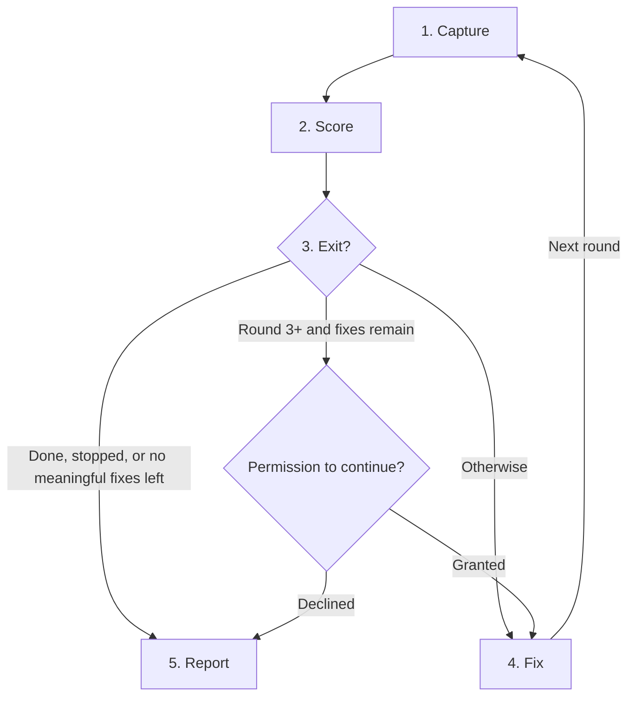

# UI Polish

## Rules

- Read the project's design standards first (`AGENTS.md`, `docs/standards`, etc.); otherwise follow existing UI conventions.
- Preserve intended behavior, except interaction changes needed for accessibility. Reuse existing components and tokens.
- Keep screenshots in the scratchpad or system temp folder; never commit them.

## Setup

- Stay focused: identify the one relevant page, theme, and light/dark mode from the request and recent changes. Don't explore further.
- Find or start the dev server from project config. Capture with the T3 Browser (T3 Code app) if available, otherwise another browser tool (e.g. Playwright); if none exists, stop and report.
- Ask once, only if something can't be inferred (page/theme/mode, or a URL or screenshot when no server runs): a numbered list of direct questions, each with a default so the user can reply "defaults".

## Process

A round is one capture, score, and fix cycle. Round 1 is the baseline.

1. **Capture** desktop (plus mobile if the UI is used on mobile) and relevant states (hover, focus, empty, error, loading) at the most revealing viewport. Also capture keyboard-focus screenshots and save the accessibility snapshot as text. Use neutral filenames in a fresh folder per round (e.g. `a1.png`). Later rounds match the first capture.
2. **Score** with a fresh, read-only subagent each round. It reviews files only, with no browser. Frame it as "review this UI" and give it only:
   - The screenshot and snapshot paths, and the viewport/state each shows.
   - The design standards text (if any), the six categories, and the scoring levels.
   - A request to score hierarchy, spacing, typography, consistency, accessibility, and responsiveness, each with one concrete observation, noting anything it couldn't judge.

   Never pass source code, project name, earlier scores or observations, fix history, round numbers, or exit thresholds. Average the six scores yourself.

3. **Exit**, checking in order:
   - Done: average of at least 9, no category below 8.
   - Stopped: a blocker; a gain under 0.3 since the previous round (from round 3); or a drop, in which case undo that round's fixes first.
   - Budget: after round 3, if meaningful improvements remain, report them and ask explicit permission for round 4, and again before each later round.
4. **Fix** quick wins first, then highest-impact issues, with no cap per round. Return to step 1.
5. **Report** a per-category before/after table with the overall change (e.g. 7.2 → 8.5), fixes made, and remaining gaps. Scores are judgments, not measurements.

| Score | Level                                                             |
| ----- | ----------------------------------------------------------------- |
| 1     | Unusable; fundamental issues prevent completing the task.         |
| 3     | Poor; major issues repeatedly obstruct use.                       |
| 5     | Usable; clear issues need attention.                              |
| 7     | Solid; visible gaps reduce clarity or polish.                     |
| 9     | Polished; only minor gaps remain.                                 |
| 10    | Excellent; no meaningful improvement found in the reviewed scope. |

Use 2, 4, 6, and 8 for in-between cases.
